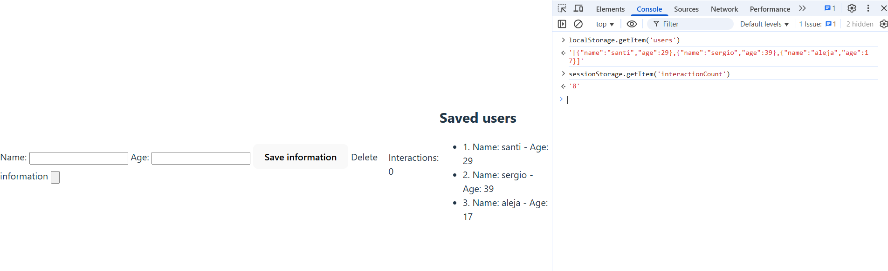

# DOM Manipulation and Browser Storage Project

This project is part of **Module 3 - Week 4** training. It demonstrates the use of **DOM manipulation**, **Local Storage**, and **Session Storage** to create a dynamic and interactive web page.

## 📌 Features

- Capture user input (name and age) via a form.
- Save user data persistently using **Local Storage**.
- Display saved user data on every page reload.
- Track and display interaction count per session using **Session Storage**.
- Allow the user to delete all stored data.
- Clean UI updates via DOM manipulation.

## 🚀 Technologies Used

- HTML5  
- CSS3  
- JavaScript (ES6+)  
- Vite (Build tool)

## 📁 Project Structure

src/
├── classes/
│ └── Person.js # Person class with validation
├── utils/
│ ├── interaction.js # Session Storage logic for interaction count
│ └── storage.js # Local Storage logic for saving users
├── main.js # Main script handling UI and logic
├── style.css # Basic styles
index.html # App entry point

markdown
Copy
Edit

## ✅ How to Run

1. Clone this repository or download the ZIP.
2. Run `npm install` to install dependencies.
3. Start the development server:
   ```bash
   npm run dev



## Author

Developed by Santiago Villa Panesso

/*
  SPA con Vanilla JS: Registro, Login, Rutas Protegidas y Roles
  Estructura profesional lista para clonar y modificar
  Autor: Santiago
*/

// =========================
// index.html (ubicado en /public)
// =========================
/*
<!DOCTYPE html>
<html lang="en">
  <head>
    <meta charset="UTF-8" />
    <meta name="viewport" content="width=device-width, initial-scale=1.0" />
    <title>SPA Auth</title>
  </head>
  <body>
    <nav>
      <a href="/" data-link>Home</a>
      <a href="/login" data-link>Login</a>
      <a href="/register" data-link>Register</a>
      <a href="/admin" data-link>Admin</a>
    </nav>
    <div id="app"></div>
    <script type="module" src="/src/main.js"></script>
  </body>
</html>
*/

// =========================
// src/main.js
// =========================
import { router } from './router.js';

document.addEventListener('DOMContentLoaded', () => {
  router();
});

// =========================
// src/router.js
// =========================
import Home from './pages/Home.js';
import Login from './pages/Login.js';
import Register from './pages/Register.js';
import Admin from './pages/Admin.js';
import { isAuthenticated, getCurrentUser } from './utils/auth.js';

const routes = {
  '/': Home,
  '/login': Login,
  '/register': Register,
  '/admin': Admin,
};

export function router() {
  const path = window.location.pathname;
  const app = document.getElementById('app');

  if (path === '/admin') {
    const user = getCurrentUser();
    if (!user || user.role !== 'admin') {
      alert('Acceso denegado');
      history.pushState({}, '', '/');
      return app.innerHTML = Home();
    }
  }

  app.innerHTML = routes[path]();

  // Navegación SPA
  document.querySelectorAll('[data-link]').forEach(link => {
    link.addEventListener('click', e => {
      e.preventDefault();
      const href = e.target.getAttribute('href');
      history.pushState({}, '', href);
      router();
    });
  });

  window.onpopstate = router;
}

// =========================
// src/pages/Home.js
// =========================
export default function Home() {
  return `
    <h1>Bienvenido a la App SPA</h1>
    <p>Usa la navegación para ir a las páginas de login o registro.</p>
  `;
}

// =========================
// src/pages/Login.js
// =========================
import { login } from '../services/userService.js';

export default function Login() {
  return `
    <h2>Login</h2>
    <form id="loginForm">
      <input type="text" placeholder="Usuario" name="username" required />
      <input type="password" placeholder="Contraseña" name="password" required />
      <button type="submit">Iniciar sesión</button>
    </form>
  `;
}

document.addEventListener('submit', async e => {
  if (e.target.id === 'loginForm') {
    e.preventDefault();
    const data = new FormData(e.target);
    const username = data.get('username');
    const password = data.get('password');
    const success = login(username, password);
    if (success) {
      history.pushState({}, '', '/');
      router();
    } else {
      alert('Credenciales inválidas');
    }
  }
});

// =========================
// src/pages/Register.js
// =========================
import { register } from '../services/userService.js';

export default function Register() {
  return `
    <h2>Registro</h2>
    <form id="registerForm">
      <input type="text" placeholder="Usuario" name="username" required />
      <input type="password" placeholder="Contraseña" name="password" required />
      <button type="submit">Registrarse</button>
    </form>
  `;
}

document.addEventListener('submit', e => {
  if (e.target.id === 'registerForm') {
    e.preventDefault();
    const data = new FormData(e.target);
    const username = data.get('username');
    const password = data.get('password');
    register(username, password);
    alert('Registro exitoso');
    history.pushState({}, '', '/login');
    router();
  }
});

// =========================
// src/pages/Admin.js
// =========================
import { getUsers, deleteUser } from '../services/userService.js';

export default function Admin() {
  const users = getUsers();
  return `
    <h2>Admin Panel</h2>
    <ul>
      ${users.map(u => `
        <li>
          ${u.username} - ${u.role}
          <button onclick="deleteUser('${u.username}')">Eliminar</button>
        </li>`).join('')}
    </ul>
  `;
}

// =========================
// src/services/userService.js
// =========================
import { saveSession, saveUsers, getUsersList } from '../utils/storage.js';

export function register(username, password) {
  const users = getUsersList();
  if (users.find(u => u.username === username)) return false;
  users.push({ username, password, role: 'user' });
  saveUsers(users);
}

export function login(username, password) {
  const users = getUsersList();
  const user = users.find(u => u.username === username && u.password === password);
  if (user) {
    saveSession(user);
    return true;
  }
  return false;
}

export function getUsers() {
  return getUsersList();
}

export function deleteUser(username) {
  const users = getUsersList().filter(u => u.username !== username);
  saveUsers(users);
  alert('Usuario eliminado');
  location.reload();
}

// =========================
// src/utils/storage.js
// =========================
export function getUsersList() {
  return JSON.parse(localStorage.getItem('users')) || [];
}

export function saveUsers(users) {
  localStorage.setItem('users', JSON.stringify(users));
}

export function saveSession(user) {
  sessionStorage.setItem('currentUser', JSON.stringify(user));
}

export function getSession() {
  return JSON.parse(sessionStorage.getItem('currentUser'));
}

export function clearSession() {
  sessionStorage.removeItem('currentUser');
}

// =========================
// src/utils/auth.js
// =========================
import { getSession } from './storage.js';

export function isAuthenticated() {
  return !!getSession();
}

export function getCurrentUser() {
  return getSession();
}
